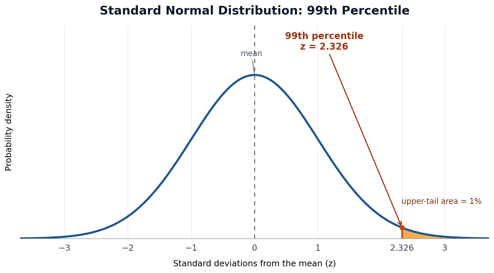

# Demands
Project intiative driven by: [The Hydraulic Consultants of Australasia Pty Ltd](https://hcaa.org.au/)
- Water Demand Investigation Project: https://www.waterdemand.com.au/
  
**Research conducted by: Deakin University**
- Research Paper: [Cold water demand investigation](https://ascelibrary.org/doi/10.1061/(ASCE)WR.1943-5452.0001625)
- Research Paper: [Peak demand formula](https://ascelibrary.org/doi/10.1061/JWRMD5.WRENG-6146)

## Features
***Follows Verification Method formula in the NCC 2025 Volume 3***  
- Codified approach, see Clause XX.X

***Size your residential projects with a modern and accurate peak demand formula!***  
- The new formula can estimate the 99th percentile demand for cold and heated water consumption.  
- All work is backed by peer reviewed research by Deakin University to better understand how we use water in Australian residential buildings.  

  
***No more imaginary "loading" or "fixture" units!***  
- The new formula uses tangible fixture flow rate values.  
- This enables water demand estimates to adapt as plumbing fixture change over time.  

***Save money, reduce energy and improve water quality!***  
- The research has shown current provisions of AS/NZS 3500 significantly overestimate the peak demand.
- This leads to oversized plumbing networks that are costly to build, are inefficient to run and lead to increase stagnation and low flow velocity that can introduce water quality risks.  

***Generate documentation for your performance solution!***  
- Generate a table of results to append to your performance solution.    
- The HCAA have even developed a performance template with all supporting information and formulas so that you don't have to.  

***Free desktop software with no accounts needed!***  
- Don't want to install before trying - test using the web version here....  

## Roadmap
- Got a feature request? Post an issue above. Keep in mind this is done on my own time.  

## Installation

## The formulas
QXCIX uses two formulas to probalablisticly estimate the 99th percentile demand in residential buildings.
Based on the work to determine associated fixture parameters it is assumed this values occurs during the peak hour of water use (consumpstion) for a given day.
These formulas are already implemented in the [IAPMO's Water Demand Calculator:] (https://iapmo.org/we-stand/water-demand-calculator).
If you want a deep dive into how these work, I suggest reading these:
- Omaghomi - XX
- Buchberger XX
  
***Hunter's fixture unit problem***
Hunter modeled each fixture group with its own probability of use (assuming a binomial distribution) and flow rate.  
Simply adding the groups’ individual 99th-percentile demands would overstate how often their peak uses happen together.  
Fixture units provided a way to combine the groups into one design curve.

***A convolution-like approach***
A convoltion is a mathematical approach used to combine two or more distribuitons of any kind into a distribution that is representative of all underlying distributions.
Three Blue One Brown gives a really good visual demonstration into the what/why/how of a convolution.
  
Now if we assume a fixtures probability of use during the peak hour follows a normal distribution $X \sim \mathcal{N}(\mu,\sigma)$:
- with a mean ($$\mu\$$) and standard deviation $${\sigma^2}$$
- where the variance is $${\sigma^2}$$

The convolution of two or more Normal Distributions is the sum of their means and variances:
- $$\mu\ = \mu_1\ + \mu_2\$$ 
- $$\sigma\ = \sigma_1\ + \sigma_2\$$

So for a given set of Normal Distributions we can estimate the 99th percentile value as 2.326 standard deviations from the mean:
- $$X_99 = \mu\ + 2.326\sigma\$$

 
***Wistort's formula***

***Modified Wistort formula for smaller buildings***

Fixture probability of use (p-values)***

## DISCLAIMER
The application is provided free and open source with all source code visible for review. Although care has been taken to ensure the accuracy, completeness, and reliability of "demands" ('Software'), the Developer nor any other party makes any warranties, express or implied, or representations regarding the accuracy of the Software. The Developer nor any other party assumes any liability or responsibility for any errors or omissions in the information contained in or output by the Software. The Developer nor any other party assumes any responsibility for the consequences of using such information, nor for any infringement of third-party intellectual property rights that may result from its use.
The Developer recommends that any user of this Software reads and reviews the data and papers written as part of the development of this method to determine the Residential 99th percentile demands within Australian (Class 2) buildings.
## License
Demands is released under the [MIT License](https://opensource.org/licenses/MIT).
